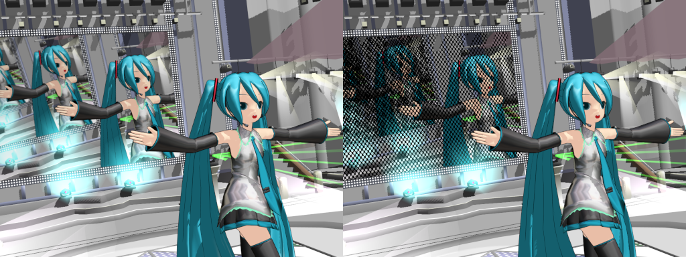

# gaj-dotscreen

## 概要
gaj-dotscreen は、MikuMikuDance のスクリーンキャプチャONで表示されるスクリーン用のエフェクトで、スクリーンの描画にドットのマスクを描画します。
- サンプル画像　左：MikuMikuDanceデフォルト表示。右：スクリーン表示部に gaj-dotscreen を割り当て。


追加の機能として、AutoLuminous Ver.4.2 、 WorkingFloorAL ver0.0.7 に対応します。

## 動作確認環境
Windows11 26H2 , MikuMikuDance Ver.9.32 , MikuMikuEffect Ver.0.37

## 同梱ファイル一覧
注意： .fx ファイルは、Shift-JISでエンコードされています。
| ファイル名 | 用途 |
| --- | --- |
| dot_screen_Main.fx | Main タブ割り当て用 |
| dot_screen_AL_EmitterRT.fx | AL_EmitterRT タブ割り当て用 |
| dot_screen_WorkingFloorRT.fx | WorkingFloorRT タブ割り当て用 |
| dot_screen_WF_EmitterRT.fx | WF_EmitterRT タブ割り当て用 |
| dot_screen_settings.fx | ユーザー設定用ファイル |
| dot_screen_common.fx | 共通設定/関数
| dot_screen_controller.pmx | コントローラー。モーフで設定を変更します |
| Screen.x | サンプル用のスクリーンオブジェクト |
| README.md | このファイル |
| dot_screen_sample_image.png | サンプル画像 |
| LICENSE | ライセンスが記載されているテキストファイル |

## 使用方法
gaj-dotscreen は、スクリーン用の .x オブジェクトに割り当てて使用します。  
AutoLuminous、WorkingFloorAL 併用時には同梱のファイルを割り当てることにより、発光、反射の表現が可能です。

### 事前準備
1. スクリーン用アクセサリを MikuMikuDance に読み込みます。（配布されているステージなどに添付されているスクリーン、または、同梱の Screen.x 等。以下スクリーンオブジェクトと呼称。）
2. MikuMikuDance の「背景」メニューから「ON・モード１」または「ON・モード２」を選択してスクリーンにキャプチャ画像が表示されることを確認します。
3. コントローラーが必要な場合は、dot_screen_controller.pmx を MikuMikuDance に読み込みます。
4. AutoLuminous 、 WorkingFloorALを使用する場合、描画順をスクリーンオブジェクト → AutoLuminous → WorkingFloorAL の順にします。

### ファイルの割り当て
"MMEffect" メニューから"エフェクト割当"を選択して、"エフェクトファイル割り当て"ダイアログを表示し、スクリーンオブジェクトを選択しエフェクトファイルを割り当てます。  
AutoLuminous 、 WorkingFloorAL を使用する場合は、追加でファイルを割り当てます。

- gaj-dotscreen の割り当て  
  | タブ | 割当先 | 割り当てファイル |
  | -- | -- | -- |
  | Main | スクリーンオブジェクト | dot_screen_Main.fx |

- WorkingFloorAL 用の割り当て  
"WorkingFloorRT" タブのスクリーンオブジェクトに dot_screen_WorkingFloorRT.fx を割り当てます。これにより、WorkingFloorAL に映るスクリーンにドットが表示されます。  
  | タブ | 割当先 | 割り当てファイル |
  | -- | -- | -- |
  | WorkingFloorRT | スクリーンオブジェクト | dot_screen_WorkingFloorRT.fx |

- AutoLuminous 用の割り当て  
スクリーンを発光させる場合、以下の割り当てを行います。  

  | タブ | 割当先 | 割り当てファイル |
  | -- | -- | -- |
  | AL_EmitterRT | スクリーンオブジェクト | dot_screen_AL_EmitterRT.fx |

  WorkingFloorAL を併用している場合、追加で以下の割り当てを行います。  
  | タブ | 割当先 | 割り当てファイル |
  | -- | -- | -- |
  | AL_EmitterRT | WorkingFloorAL.x | WorkingFloorAL 同梱の AL_WorkingFloor.fx |
  | WF_EmitterRT | スクリーンオブジェクト | dot_screen_WF_EmitterRT.fx |

### 設定
gaj-dotscreen 用の設定は、 dot_screen_settings.fx で設定します。MikuMikuDance起動中にこのファイルを変更した場合は自動で適用されないので、"MMEffect" メニューから"全て更新"を行って適用します。  

ユーザーが設定出来る値は以下です。
```glsl
// x方向のDot数（DotAngle=0の時を基準にしています）
float	DotX = 128.0;
// ドット描画時の角度。スクリーン左上を基準に、正の数で反時計回り、負の数で時計回りの角度を示す
float   DotAngle = -45.0;
// Dotサイズ（0.0 ～ 1.0 ～ 1.4142135）正方形内に描画される最大の円の大きさ
float	DotSize = 0.5;
// 黒オフセット（0.0～1.0）黒色で描画するマスクの色。スクリーンの色に乗算される
float   BlackOffset = 0.0;
// 映像の黒レベル（±1.0）黒レベルを上げることで、真っ黒な画面でもドットを認識することが出来る。
float   BlackLevel = 0.0;
// スクリーン比率。使用するスクリーンの比率（X:Y）を設定します
float2  AspectRatio = float2(16.0, 9.0); // or (4.0, 3.0)
// ----------------------------------------------------------------------------
// AutoLuminous を使用する時の設定
// スクリーンを光らせるフラグ。光らせない場合はコメントアウト。
#define EMMISIVESCREEN  true
// AutoLuminous の仕様に基づく光量（100.0以上：発光させる材質の反射強度値に相当）
#define EMMISIVEAMOUNT  106.0
```

### コントローラー
dot_screen_controller.pmx （以降、コントーローラーと呼称）を MikuMikuDance に追加すると下記に示したモーフを使用して設定を変更することが出来ます。コントローラーが無い場合はデフォルトの設定が使用されます。

- size+/-  
ドットのサイズを変更します。設定の DotSize を初期値として モーフの値をを加減算します。結果として0.0～1.4142135(2の平方根)の値になります。
- width+/-  
スクリーンのx方向のドットの数を変更します。設定の DotX を初期値として DotX 分を加算、減算します。最小値は1、最大値は DotX の2倍。
- angle+/-  
ドット描画時の角度。設定の DotAngle を初期値として 90°分を加算、減算します。
- mask black offset+/-  
マスクの黒部分のオフセット値を設定します。+のモーフ値を上げるとマスク部分が薄くなります。
- black level+/-  
スクリーンに表示される映像の黒レベルを調整します。black level+ 値を上げると真っ黒な画面でも明るくなり、ドットを認識することが出来ます。逆に値を下げると黒つぶれした画像になります。  

以下は AutoLuminous 併用時に有効なモーフです。
- LightUp  
最大3倍まで明るくなります。
- LightOff  
MAXで完全に発光が消えます。
- LightBlink  
発光の点滅（サイン波点滅）
- LightBS  
発光の点滅（矩形波点滅）
- LightUpE  
明るさが指数関数的に上昇します。最大で400倍。
- LightDuty  
点滅のオンとオフの比率を変えることができます。
- LightMin  
点滅時の最小明るさを設定できます。


## ライセンス
本プロジェクトはMITライセンスの下でライセンスされています。詳細は LICENSE.txt ファイルを参照してください。  
This project is licensed under the MIT License, see the LICENSE.txt file for details.  


## 履歴
ver.1.0 初版
